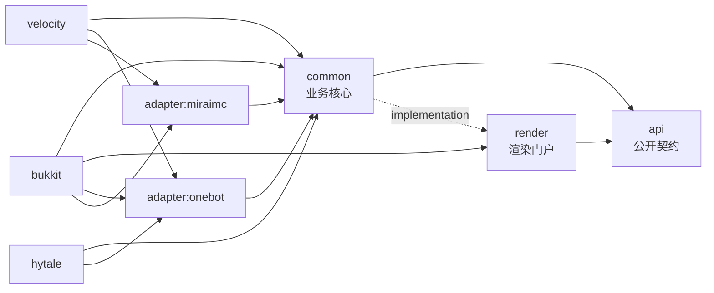

# 架构概览

PlumBot 把 Minecraft 服务端与 QQ 群双向打通：一套面向第三方的公开契约、一份平台无关的业务核心、一个独立渲染门户，加上多端宿主装配和两种 Bot 协议适配。本文按当前代码描述结构，不描述规划。

相关文档：[渲染子系统](render.md)、[内部核心开发](internal-dev.md)、[构建与发布](build-and-release.md)、[新平台接入](adding-platform.md)、[附属插件开发](extension-guide.md)。

## 模块分层与依赖方向

`settings.gradle.kts` 声明 8 个模块，根项目名为 `PlumBot-V3`。依赖方向单向：实现依赖契约，宿主依赖实现，业务代码反向引用平台类即视为错误。



- `api`：对外契约与模型（`PlumBotAPI`、`IBot`/`BotFactory`、`PlatformContext`、`IDatabase`、事件类型）。只 `compileOnly` Adventure，运行期用 kotlinx 协程与 datetime，不依赖任何实现模块。
- `render`：渲染门户的公开面（`RenderProvider`、`RenderPortal`、`RenderRoute`、`RenderCard`、`RenderResult`），实现类全部 `internal`；Playwright 仅 `compileOnly`，运行期按需装载。
- `common`：生命周期、命令服务、事件桥、数据库、词库、缓存与 Bot 抽象（`AbstractBotAdapter` 也在这里）。它以 `implementation(project(":render"))` 引用渲染，因此适配层与第三方插件都看不到渲染内部类型。
- `adapter:onebot` / `adapter:miraimc`：只依赖 `common`，负责协议收发与能力声明，不做业务判断，也不接触渲染。
- `bukkit` / `velocity` / `hytale`：唯一的装配层，依赖 `common`、`render` 和所需适配器（Hytale 只带 OneBot），承担平台线程、命令注册、事件监听与资源归属。

同一套代码在三端的差异只在装配细节：`bukkit` 以 Spigot API 1.13 为编译基线以覆盖较老服务端，`velocity` 编译基线为 Velocity 3.5.1 并声明对 MiraiMC 的可选依赖，`hytale` 使用动态版本编译且只装配 OneBot。平台调度器、玩家服务、日志等能力统一由 `PlatformContext` 抽象提供，`common` 中不出现条件编译。前端模板已迁至独立仓库，本仓库不含页面代码。

## 启动与关停时序

宿主入口只做平台相关的事，共享顺序在各端一致：

1. 装载运行库并注册 `RenderLibraryLoader`，让渲染门户在需要时触发 Playwright 下载，而不是在启动期同步落盘。
2. 读配置：`ConfigMigrator.completeMissingDefaults` 先补齐缺失键，再由 `YamlConfigurator` 载入 config / datasource / messages，最后 `MessagesBinder` 绑定消息模板。
3. 注册 Bot 工厂（`bot.type=miraimc` 且 MiraiMC 已启用时用 MiraiMC，否则 OneBot）、发布 `PlumBotAPI`、把 `BotEventDispatcher` 挂到当前插件。
4. 进入共享的 `PlumBot.enable()`：`loadConfig` → 调试设施 → `applyRenderConfig` → `loadDatabase` → 异步 `loadBot`。
5. 装配词库并异步预热，注册平台监听器与 `/plumbot` 命令。

实际顺序是「配置 → 渲染门户 → 数据库 → Bot」，渲染门户早于数据库装配：Bot 是异步创建的，QQ 侧消息一旦先到，渲染门户必须已经可用。`applyRenderConfig` 只在门户尚未装配时 `bootstrap`，重载时复用现有门户并只调用 `configure`，避免同步关闭 Chromium 拖慢主线程。

各端入口的差异：

- `bukkit`：`onEnable` 里还注册 `ServerListener`、`PluginListener`（以及启用 MiraiMC 时的桥接监听器）与 `/plumbot` 命令；`reloadPlugin` 重读配置、重配门户、异步重载词库，不重建插件实例。
- `velocity`：入口注解声明插件 id，版本号来自构建期生成的 `BuildConstants`，MiraiMC 为可选依赖；重载与关停分别走代理的 reload、shutdown 回调。
- `hytale`：拆成 `setup()` 与 `start()`，前者只装载依赖与配置，后者才创建 Bot 与门户；`shutdown()` 额外收尾平台调度器。

关停顺序由 `PlumBot.disable()` 固定，不能随意调整：

```text
Bot 卸载 → RenderProvider.shutdownAndAwait() → 数据库 → 任务调度 → 调试设施 → ShutdownRegistry 兜底
```

渲染门户必须被等待的原因很具体：门户的 `shutdown()` 是投递到回收线程的异步动作，若 `disable()` 立即返回，平台会先关闭插件类加载器，而回收线程仍在执行 Chromium 与 Playwright 的关闭流程，线上表现为类加载器抛 `zip file error`。`shutdownAndAwait` 默认最多等 3 秒，超时只打一条 WARN（驱动交给 JVM 回收），不会让关服卡死。随后宿主注销 Bot 工厂、清空 API 注册表与事件派发器的插件绑定。

## 消息与事件流转

QQ 侧到游戏侧的路径：

1. 适配器收到群消息或退群事件，转成统一模型后交给 `BotEventDispatcher`。
2. 派发器先调用内置处理器 `DefaultBotHandler`，用 `runCatching` 隔离异常；再派发给第三方注册的 `GroupMessageEvent` / `GroupMemberDecreaseEvent` 监听器，内置处理失败不会阻断外部监听器。
3. 内置处理器按 `command.keys` 的别名表识别命令（`list`、`addBind`、`deleteBind`、`queryBind`、`status`、`remote_console`、`avatar`），别名表指纹变化才重建注册表；每个命令先过对应 feature 开关，再交给白名单、玩家列表、状态、远程控制台、头像等服务。
4. 普通聊天交给 `MessageForwardService`：按模式判断是否转发、过滤敏感词、转义 MiniMessage，最后广播到游戏内。
5. 命令需要出图时统一走 `BotCommandService`：先校验 `GROUP_MESSAGE_SEND` 能力，再检查门户是否存在、该路由是否开启出图，最后渲染；发送失败或图片被拒时回落为纯文本，不会丢消息。

消息模式与前缀由 `MessageModeResolver` 统一解析，转发前统一做 MiniMessage 转义与词库过滤，避免玩家聊天内容被当作组件语法执行。

游戏侧到 QQ 侧的路径：

1. 各平台监听器把事件交给 `GameEventBridge`，覆盖聊天、进服、退服、换服、死亡、成就、踢出。
2. 桥接层统一做开关判断（如 `feature.message.enable`、`feature.message.to_group`、`joinProxy`、`leaveProxy`）、去格式化、词库过滤与消息模板渲染。
3. 出图时交给 `ServerMessageSender.broadcastRendered`：一次渲染得到字节，多个群复用同一份，某个群发送失败只降级该群。
4. 登录时由 `PlayerLoginService` 做白名单校验，缓存优先、有界等待、失败即拒绝（见决策 D17），避免数据库抖动把所有人放进来。

跨平台差异通过能力枚举表达：`PlatformCapability`（如换服广播）与 `BotCapability`（如发图、拉群名片）在调用前检查，缺失能力时明确报错或降级，而不是让业务代码在运行期撞 `UnsupportedOperationException`。第三方插件只能通过 `PlumBotAPI` 与监听器接入，不能直接持有适配器实例。

## 运行期装配与作用域

- 每个宿主只创建一个插件实例与一份 `PlumBotAPI` 注册项；`PlumBotApiProvider` 只持有注册点，宿主卸载时显式注销，避免第三方缓存到已失效的对象。
- 调度分层：`PlatformScheduler` 负责把任务排到主线程或平台线程池，`TaskProviderImpl` 在其上提供异步提交（Bot 的创建就走这里）；需要 tick 语义的代码必须显式走平台调度，`common` 里不出现裸线程。
- 渲染与跨群广播各自使用 `Dispatchers.IO` 加 `SupervisorJob` 的协程作用域，单个群或单张图失败不会取消兄弟任务，并统一注册进 `ShutdownRegistry` 在关停时取消。
- 命令服务的配置读取是 getter 而非构造期快照，重载替换配置实例后无需重建服务对象，这是重载不重启插件的关键。
- 数据库实现按 `database.mode` 选择 SQLite 或 MySQL，未知值回落 SQLite 并记 ERROR；建表与迁移逻辑集中在 `common`，由各宿主复用。

## 数据与持久化

- 连接参数在 `datasource.yml`，模式由 `database.mode` 决定（`sqlite` 或 `mysql`）；未知值回落 SQLite 并记 ERROR，SQLite 路径支持 `%plugin_folder%` 变量。
- 绑定关系是跨群共享的核心数据，表里以可空的 `source_group` 标记来源群；退群解绑只删除来源为本群的行（D2）。
- 进服时若绑定行缺少玩家 UUID 会补写，避免同名玩家换号后失效；退群事件由内置处理器按来源群解绑。
- 白名单登录校验读绑定与群成员缓存，缓存 TTL 与陈旧复用策略见 D17；数据库不可用时按失败处理，不放行。
- 远程控制台的命令审计写入日志通道而不是业务库，粒度由 `remote_console.log_commands` 控制（D9）。

## 渲染子系统

渲染门户是唯一出图入口，命令与事件只提交「渲染哪条路由 + 载荷」，不关心用哪种引擎画。

```text
命令 / 事件
  → ServerMessageSender.broadcastRendered（渲染一次，多群复用）
  → RenderProvider.portal.render(RenderRequest)
  → ImageRenderManager：路由解析 → 语义容量 → 同目标串行 → 载荷治理
  → PlaywrightImageRenderer（页面池 + 模板）  或  AwtImageRenderer（兜底）
  → PNG 字节 → IBot.sendGroupImage(ByteArray) → QQ 群图片；失败回落纯文本
```

- 路由：`RenderRoute` 现有 17 条，映射到 `render.outputs` 的 13 个开关（`load` 覆盖进服/退服，`bind` 覆盖绑定与查询，`joinAndLeave` 覆盖进退服与换服，`avatar` 覆盖头像与旧模板头像）。`render-protocol.json` 以 `protocol=1` 声明同样的路由与 text 样式，构建期与枚举双向校验。
- 引擎选择：`render.engine=auto`（默认）时按路由首选——头像走 Playwright，其余走 AWT；`render.views.<route>` 可逐路由覆盖引擎与超时。Playwright 失败且 `fallback_to_awt=true` 时降级 AWT，再失败降级纯文本。
- 门户生命周期：`warmUpEngines()` 只调度装载、立即返回；`ensurePlaywrightLibrary()` 才会阻塞，供 `/plumbot render doctor|install` 使用；`reload()` 只在字体、UA、文本样式等配置指纹变化时重建引擎。

关键并发与容量常量（以源码为准，配置文件中的同名键只是可调覆盖）：

| 常量 | 值 | 作用 |
|---|---|---|
| `CONCURRENCY` | 2 | 同时进行的渲染任务上限 |
| `QUEUE_DEPTH` | 6 | 额外的排队槽位；与并发合计 `Semaphore(8)` |
| `PAGE_POOL_SIZE` | 1 | Playwright 页面池大小 |
| `DEFAULT_TIMEOUT_MS` | 3500 | 单次渲染超时，对应 `render_timeout_ms` |
| `DEFAULT_SCALE_FACTOR` | 1.5 | 截图缩放，允许 1.0–4.0 |
| `PLAYWRIGHT_LOAD_COOLDOWN_MS` | 60000 | 装载失败后的冷却窗口 |
| `DEFAULT_TEARDOWN_TIMEOUT_MS` | 3000 | 关停等待上限 |

容量满时门户立即返回 `Unavailable` 并降级纯文本，不排队、不丢弃、不阻塞调用线程；同一目标（群或玩家）的渲染用 `Mutex` 串行，避免同一目标的图片乱序。载荷治理按 `render.limits` 截断正文、限制层数与二进制总量，超限部分记录指标而不是抛异常。引擎只装配 AWT，Playwright 在首次真正需要时惰性构造，避免只用 AWT 的部署在启动期就撞上 Playwright 驱动的类依赖。

头像单独一条管线：`AvatarResolver` 从玩家档案解析皮肤纹理，`MinecraftSkinCropper` 裁出头像层，`AvatarCache` 落盘缓存并按 TTL 与文件上限修剪（默认 2048 个文件、168 小时）；远端域名需通过 `render.avatar.domains` 白名单放行，单层与总量受 800 毫秒、3000 毫秒预算约束。渲染健康状态由 `renderHealth()` 与 `metrics()` 暴露，`/plumbot render doctor` 据此输出引擎可用性、失败冷却剩余时间与最近失败原因。

## 构建与发布链路

`buildSrc` 提供两个约定插件，各模块只声明差异：

- `buildsrc.convention.kotlin-jvm`：应用 Kotlin JVM，统一 `jvmToolchain(25)`、JUnit Platform 与测试临时目录；`BuildConstants` 生成是按需的，只有声明了 `plumbotBuildConstants` 的 `velocity` 才会生成。
- `buildsrc.convention.platform-distribution`：在 JVM 约定之上叠加 Shadow，把第三方库重定位到 `me.regadpole.plumbot.lib`，排除签名文件与 brigadier，并以 `assemble` 依赖 `shadowJar`。Adventure/MiniMessage 不重定位也不打包，由宿主提供（Hytale 缺失时由 Libby 运行期装载）。

版本集中在 `gradle/libs.versions.toml`（Kotlin 2.4.0、Adventure 4.21.0、Velocity 3.5.1、Playwright 1.49.0、Shadow 9.1.0、bStats 3.2.1 等），模块只引用 alias 与 bundle，不在脚本里写字面版本。构建要求 JDK 25，本地缺失时由 `settings.gradle.kts` 里的 foojay 工具链解析器补齐。

产物归集由根项目的 `dist` 任务完成：三个宿主模块的 `shadowJar` 输出分别命名 `PlumBot-Bukkit`、`PlumBot-Velocity`、`PlumBot-Hytale` 并复制到 `dist/`。三个产物共享同一份 `common` 与 `render` 代码，差异只在宿主 API 与入口类；升级依赖时先改 `libs.versions.toml`，再跑校验任务确认装载清单与协议没有脱节。

`check` 链上挂着四个根校验任务（另有 `:api:checkApiContract` 挂在 `:api:check`）：

- `checkRenderBoundaries`：扫描源码，禁止适配层与宿主引用渲染内部类型，`:render` 的公开声明必须带 `@PublicApi` / `@StableApi` / `@ExperimentalApi`。
- `checkRenderProtocol`：`render-protocol.json`、`RenderRoute` 枚举、`config.yml` 的 `render.outputs` 与 text 样式四方一致。
- `checkRuntimeLibraries`：`compileOnly` 声明必须能在 `RuntimeLibraries` 装载清单里找到，反之亦然；宿主提供的库与按需装载的 Playwright 在豁免表内。
- `checkSingleDefinitions`：玩家名规则只允许一处定义，防止各服务各写一份正则。

这些任务是发布前的硬门禁，而不是建议：任一失败都意味着某条契约已经被破坏。`checkRelocation` 需要先有 `dist/` 产物，因此不挂在 `check` 上，发布前单独执行，断言产物里不含任何 kyori 类与旧命名空间前缀（Gson 保留原前缀，与宿主共用）。本地校验顺序：`./gradlew build` → `./gradlew dist` → `./gradlew checkRelocation`。